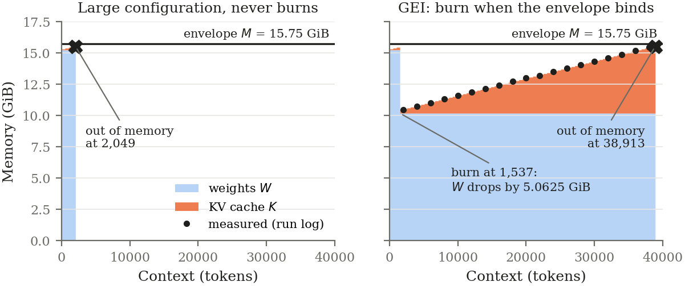
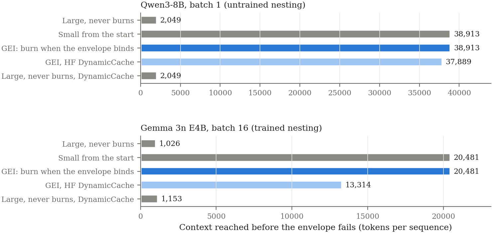
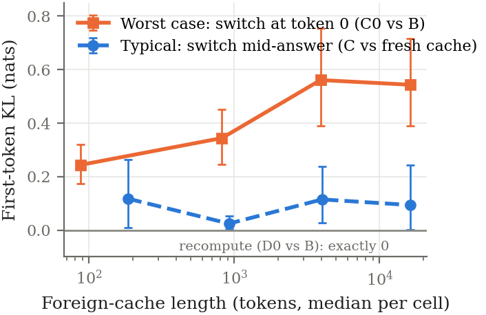

# Godwit Endurance Inference (GEI)

A language model that shrinks its own weights **during a single generation**, on
a schedule planned before launch, to free memory for its growing context — and
checks beforehand whether the task can finish at all.

Inspired by the Bar-tailed Godwit, which burns its own body tissue in flight and
decides before departure whether an 11,000 km non-stop crossing is possible.

<p align="center">
  
</p>
<p align="center"><em>Measured on Qwen3-8B, batch 1, under a 15.75 GiB envelope. Left: the large model runs out of memory at 2,049 tokens. Right: GEI burns once at 1,537 tokens, freeing 5.06 GiB of weights, and the KV cache grows into that space until 38,913 tokens.</em></p>

**Notation.** `W(c)`: memory held by the weights of configuration `c`; `K_t`: KV-cache memory after `t` tokens; `M`: the fixed memory envelope (VRAM); `κ`: KV-cache bytes per token; `c_t`: the active nested sub-model, which can only shrink.

```
W(c_t) + K_t  <=  M          weights and context share one fixed envelope
c_{t+1} ⊆ c_t                burning is irreversible within a task
```

A conventional system holds `W` fixed, so a long task fails at
`T = (M − W)/κ`. GEI walks `W` down a nested family, extending the reachable
horizon to `(M − W_min)/κ` and spreading the quality cost across the task
instead of ending in a crash.

**TL;DR.** Burning extends how much context a fixed memory envelope can hold: **+36,864 tokens** on Qwen3-8B at batch 1, exactly as predicted (memory and horizon only; nesting untrained), and **+19,455 tokens per sequence** on Gemma 3n E4B at batch 16, in a pre-registered run. Continuing from the larger model's KV cache after a downward switch showed no detected accuracy cost, from a 184-token to a 16k-token cache. At equal memory, burning **outperforms KV-cache eviction** on long prompts: 62% vs 36% (SnapKV) and 0% (StreamingLLM) at 4k tokens, 40% vs 6% and 0% at 16k.

**Paper:** arXiv link to be added.

## Status

The control logic is implemented and unit-tested, and the Experiment 1 pilot,
the switch-shock studies, the range gain at batch 1 and batch 16, and the
comparison with KV-cache eviction have run on real models (table below).
Next: validating the scheduling policy, and Experiment 2 (the cost of burning
at each point of a task).

| Component | State |
|---|---|
| Envelope, burn schedule (DP), launch check, controller | Implemented and unit-tested on CPU (mock backend); scheduling policy not yet validated empirically |
| Metrics (switch shock, accuracy, calibration) | Implemented |
| Mock elastic model (CPU) | Implemented — validates the harness only |
| `HFElasticModel` (real nested model) | Implemented (FFN chunks split at load, one buffer per burn level); not yet wired into `run_exp1.py` |
| Experiment 1 pilot, Gemma 3n E4B, GSM8K n=100 | **Case (1): KV reuse works.** C 0.85 vs B 0.82, paired C − B +0.03 [−0.04, +0.10]; small config is a mix-and-match variant, not E2B — `docs/EXP1_PILOT.md` |
| Switch shock vs foreign-cache length (184 to 16k tokens) | **KL saturates by ~1k, flat to 16k; C never separates from D.** Retrieval from deep in a foreign cache not yet tested — `docs/EXP1_DOSE.md` |
| Worst case: switch at token 0, prompt cache entirely foreign (88 to 16k tokens) | **Exact first-token shock grows to ~4k then saturates (KL 0.24→0.56; recompute = 0 exactly); no accuracy cost — C0 ≥ B in every cell.** A second operating regime, not just a bound — `docs/EXP1_WORST.md` |
| Range gain, Qwen3-8B, batch 1 | **+36,864 tokens, exactly as predicted** (horizon and memory only: nesting untrained) — `docs/RANGE_GAIN.md` |
| Range gain, Gemma 3n E4B, batch 16, pre-registered | **+19,455 tokens per sequence**, reaching exactly the small configuration's own horizon (20,481) — `docs/RANGE_GAIN_BATCHED.md` |
| Against KV-cache eviction at equal memory, pre-specified | **GEI 0.62 vs SnapKV 0.36 and StreamingLLM 0.00 at 4k; 0.40 vs 0.06 and 0.00 at 16k**; eviction is better on short overflows (1k) — `kv-eviction-comparison/RESULTS.md` |
| Envelope constants in `configs/` | **Guesses. Run `scripts/calibrate.py` first.** |

## Pre-registration

Four analyses were fixed before their data existed: the Experiment 1 decision
rule (`scripts/run_exp1.py`), the worst-case protocol
(`docs/EXP1_WORST_PREREG.md`), the batched range gain
(`docs/RANGE_GAIN_BATCHED_PREREG.md`) and the comparison with KV-cache eviction
(`kv-eviction-comparison/docs/PREREG.md`). Their SHA-256 fingerprints are in
[`PREREG_SHA256SUMS`](PREREG_SHA256SUMS); check that the files are unchanged
with

```bash
sha256sum -c PREREG_SHA256SUMS
```

The three pre-registration documents are byte-identical to their registered
versions; `scripts/run_exp1.py` differs from its registered version (commit
`ebadf1e`) only by the licence header added before release. This repository is
a clean release. The commit hashes cited in the paper refer to the full
development history, which is archived and available to editors and reviewers
on request; [`docs/COMMITS.md`](docs/COMMITS.md) lists each cited commit, its
date and message, and the documents it is cited for.

## Results figures

<p align="center">
  
</p>
<p align="center"><em>Context reached before the memory envelope fails. GEI starts with the large model and reaches as far as the small model does.</em></p>

<p align="center">
  
</p>
<p align="center"><em>First-token KL divergence right after a downward switch, against the length of the cache the larger model wrote (log scale). The typical mid-answer switch stays low at every length; the worst case (switch at token 0) grows until about 4k tokens and then levels off. Recomputing the cache gives exactly 0.</em></p>

## Quick start

```bash
conda create -n gei python=3.11 -y && conda activate gei
pip install -e ".[dev]"          # core + tests, no GPU needed
pytest                           # 54 CPU tests, ~2 seconds (HF backend tests skip without torch)
python scripts/demo_schedule.py  # see the whole idea run, no GPU, no model
```

Then on the GPU machine:

```bash
pip install -e ".[gpu]"
python scripts/check_env.py                              # verify CUDA, VRAM, packages
python scripts/calibrate.py --model <your-elastic-model> # measure the real constants
```

## Models

Every script loads its model at a pinned Hugging Face revision
([`src/gei/revisions.py`](src/gei/revisions.py)), so a fresh download fetches
the exact weights behind the reported numbers:

| Model | Revision |
|---|---|
| `google/gemma-3n-E4B-it` (gated: accept the licence on Hugging Face first) | `c1221e9c62e34a43ab7ffacd1be0ea71f126ef10` |
| `Qwen/Qwen3-8B` | `b968826d9c46dd6066d109eabc6255188de91218` |

GSM8K is pinned in the scripts at `openai/gsm8k` revision `740312add8`.

## What is new

Related work and how GEI differs:

| Work | Does | Needs length up front? |
|---|---|---|
| [RAP](https://arxiv.org/abs/2505.17138) | Joint weights + KV memory budget, one config **per request** | Yes |
| [PM-KVQ](https://arxiv.org/abs/2505.18610) | Progressive **KV** quantisation during decoding | Yes |
| [MatFormer](https://arxiv.org/abs/2310.07707) | Nested sub-models, size fixed **per deployment** | No |
| [Nemotron Elastic](https://arxiv.org/abs/2511.16664) | Nested 6B/9B/12B; lists dynamic routing as **future work** | No |
| [StreamingLLM](https://arxiv.org/abs/2309.17453), [SnapKV](https://arxiv.org/abs/2404.14469), [H2O](https://arxiv.org/abs/2306.14048) | Keep the weights, **evict context** to fit the memory | No |
| [Star Elastic](https://arxiv.org/abs/2605.07182) (ICML 2026; same NVIDIA team as Nemotron Elastic; [card](https://huggingface.co/nvidia/NVIDIA-Nemotron-Labs-3-Elastic-30B-A3B-BF16)) | Nested 30B/23B/12B; switches **once per request** at the thinking/answering boundary, **upward** (23B thinking → 30B answering); weights not freed at runtime; no completion prediction. Card: nested variants preserve layer structure, "enabling cache-state transplantation"; in-generation switching needs a custom inference path, vLLM support in progress | Yes (fixed thinking budget) |

**Taken as given:** the shared memory envelope (RAP), importance ranking (RAP),
nested trainable sub-models (MatFormer, Nemotron Elastic), switching sub-model
by reasoning phase (Star Elastic).

**New here:** burning *downward* mid-generation and releasing the freed weight
memory to the KV cache, so the context can grow into it; a burn schedule planned over a task of *unknown* length; a launch-time
completion prediction with go/no-go; energy and heat as constraints with
fuel-mix switching (RAP lists energy as a limitation).

Not claimed: switching between nested sub-models mid-generation, or reusing
the cache across a switch. Star Elastic's card states both as properties of its
architecture, pending inference-framework support. GEI's distinct claim is the
direction (down only) and what the switch is for (memory handed to the cache).

## The two questions GEI must answer

1. **KV mismatch.** After shrinking, the small model must continue from a cache
   its larger parent wrote. Star Elastic's card says its nested variants
   preserve layer structure, "enabling cache-state transplantation", but its
   switch goes up, not down. Whether a *smaller* model can continue from a
   *larger* one's cache without a quality loss is what Experiment 1 measures:
   no detected accuracy cost, mid-answer and from the first token, up to a
   16k-token cache (`docs/EXP1_DOSE.md`, `docs/EXP1_WORST.md`).
2. **The cost of burning.** How much accuracy does burning cost, and at which
   point in the task does it cost most? If every burn point costs too much,
   completion is bought at an unusable quality. → Experiment 2.

The paper's central claim is **task completion under a binding envelope**, not
quality preservation. Burning trades some accuracy for finishing at all;
Experiment 2 measures the price. (An earlier hypothesis, that required capacity
falls as a task progresses, is dropped: Star Elastic's best configuration uses
the *larger* model for the final answer, the opposite direction.)

## Experiment 1

```bash
python scripts/run_exp1.py --backend mock     # harness check, runs anywhere
python scripts/run_exp1.py --backend hf       # the real thing (needs the backend wired in)
```

| Condition | Setup | Role |
|---|---|---|
| A | Large throughout | Upper bound |
| B | Small throughout | Reference |
| C | Switch mid-generation, **reuse** KV | GEI as proposed |
| D | Switch mid-generation, **recompute** KV | Costly fallback |

Decision rule, applied automatically by the script:

1. C matches B within noise → reuse works, build the controller.
2. C below B but D recovers → add partial recomputation, budget its cost.
3. Both fail → switch-aware ("burnability") training, then rerun.

## Layout

```
src/gei/
  envelope.py      W + K <= M, range gain, energy per token
  length_prior.py  belief over task length T (lognormal or empirical)
  schedule.py      exact DP for the burn schedule + reactive ablation
  launch.py        launch check, go / go-leaner / no-go
  elastic.py       backend interface, CPU mock, HF backend
  kvcache.py       block-allocated growable KV cache + blocked attention
  paged_decode.py  fused Triton decode attention over the cache's blocks
  controller.py    in-flight control, replanning, fuel-mix switching
  metrics.py       switch shock (KL), pass@1, bootstrap CI, ECE
  revisions.py     pinned model revisions used by every script
scripts/
  check_env.py     hardware and package check
  calibrate.py     measure kv_bytes_per_token, reserve, alpha on your GPU
  demo_schedule.py end-to-end walkthrough, no GPU
  run_exp1.py      Experiment 1 runner + decision rule
  range_gain.py    tokens-to-OOM under a fixed envelope: never burn / burn / small
  exp1_pilot.py    Experiment 1 pilot on Gemma 3n E4B (GSM8K, conditions A-D)
  exp1_dose.py     switch shock vs foreign-cache length (+ exp1_dose_report.py)
  exp1_worst.py    switch at token 0, pre-registered (+ exp1_worst_report.py)
  range_gain_batched.py  range gain at batch 16 on Gemma 3n, pre-registered
  make_figures.py  every figure, from the committed result files only
docs/              experiment reports, pre-registrations, cited commits (COMMITS.md)
results/           per-trial records and run summaries
kv-eviction-comparison/  GEI against StreamingLLM and SnapKV at equal memory
configs/rtx4090.yaml
tests/             54 CPU tests + 42 HF backend tests (need torch; 16 need CUDA)
```

## Running on one RTX 4090

Feasible, with the study designed around 24 GB. Use a MatFormer-style model with
FFN-only nesting (shared attention, so the KV layout survives a switch) as the
primary; 8-bit weights for anything near 12B. Experiment 1 at 100 problems is
roughly a day of GPU time with batching.

The results demonstrate the principle at small scale, not at frontier scale.

## Caveats

- Every number in `configs/` is a placeholder until `calibrate.py` runs.
- The mock backend's switch shock is a **parameter you set**, not a measurement.
  It cannot tell you whether GEI works.
- `switch_to` must genuinely free VRAM, and the KV cache must be able to claim
  it. Verified on Qwen3-8B: weights split at load and packed into one buffer
  per burn level give 100% reuse; splitting alone leaves small chunks
  stranded. See [docs/VRAM_FINDINGS.md](docs/VRAM_FINDINGS.md); rerun
  `scripts/verify_vram_free.py` on the Experiment 1 checkpoint.

## License

Copyright 2026 Hossein Jamali and Frederick C. Harris, Jr.

| Part | License |
|---|---|
| Code: `src/`, `scripts/`, `tests/`, `configs/`, `kv-eviction-comparison/scripts/` | Apache License 2.0 ([LICENSE](LICENSE), [NOTICE](NOTICE)) |
| Data and documentation: `results/`, `docs/`, and the other files in `kv-eviction-comparison/` | Creative Commons Attribution 4.0 International, CC BY 4.0 ([LICENSE-DATA](LICENSE-DATA)) |

Third-party data and models used by the experiments keep their own licenses:
GSM8K (MIT), Gemma 3n (Gemma Terms of Use), Qwen3-8B (Apache-2.0).
